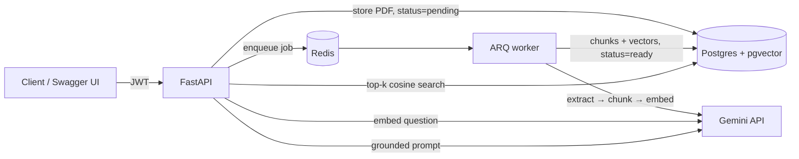

# DocQA: ask questions about your PDFs and get answers with page citations

A retrieval-augmented generation (RAG) app: a **FastAPI + PostgreSQL/pgvector + Gemini** backend with a
**React + TypeScript** frontend.
Users upload PDFs. The service extracts, chunks, and embeds them in the background. Questions are answered
**only** from the user's own documents, and each answer cites the file and page it used.


## Features

- **JWT authentication** with bcrypt password hashing; every document and query is scoped to its owner
- **Async PDF ingestion**: upload returns `202 Accepted`; extraction, chunking, and embedding run in an
  **ARQ worker** (Redis queue) or as a FastAPI background task in single-process mode
- **Vector search in Postgres** with pgvector and an **HNSW index** on cosine distance, so there's no separate vector DB to run
- **Grounded answers with citations**: each answer returns the source chunks with filename, page, similarity
  score, and whether the model actually cited it
- **Per-user daily query quota** (HTTP 429) to protect the LLM free tier
- **Resilient LLM calls**: exponential-backoff retries on rate limits and 5xx errors only
- **Pluggable LLM provider**: Gemini in production, a deterministic offline fake for tests and CI
- **React + TypeScript frontend** (Vite): login/register, drag-and-drop upload with live status polling,
  and a chat view whose `[n]` citation markers open the exact source passage and page
- **Production basics**: Alembic migrations, Docker Compose, GitHub Actions (lint + tests + image build),
  tests against **real Postgres + pgvector**

## Architecture



**Query flow:** embed the question → find the top-k nearest chunks from *this user's* ready documents →
build a prompt with numbered sources → Gemini answers with `[n]` citations → return the answer and the sources.

## API

| Method | Path | Description |
|---|---|---|
| `POST` | `/auth/register` | Create an account |
| `POST` | `/auth/login` | OAuth2 password form → JWT |
| `GET` | `/auth/me` | Current user |
| `POST` | `/documents` | Upload a PDF (≤10 MB) → `202`, ingested in the background |
| `GET` | `/documents` | List your documents and their status |
| `GET` | `/documents/{id}` | Poll ingestion status (`pending` → `processing` → `ready` / `failed`) |
| `DELETE` | `/documents/{id}` | Delete a document and its chunks |
| `POST` | `/query` | Ask a question; optionally restrict it with `document_ids` |
| `GET` | `/queries` | Paginated question history |
| `GET` | `/health` | Liveness + DB check |

Interactive docs are at `http://localhost:8000/docs`. Click **Authorize** and log in with your email and password.

Example response from `POST /query`:

```json
{
  "answer": "You can request a full refund within 30 days of delivery [1].",
  "citations": [
    {"index": 1, "document_id": 3, "filename": "policies.pdf", "page": 2,
     "snippet": "Refund policy: customers may request a full refund within 30 days...",
     "score": 0.8123, "cited": true}
  ]
}
```

## Running it

### Quickest: one command, no Docker or Postgres install

```bash
python -m venv .venv
.venv\Scripts\pip install -r requirements-dev.txt     # macOS/Linux: .venv/bin/pip
cp .env.example .env                                  # add your GEMINI_API_KEY
.venv\Scripts\python scripts/dev.py
```

This starts an embedded Postgres with pgvector (data kept in `.pgdata/`), runs migrations, and serves the
API at http://127.0.0.1:8000/docs.

Then start the frontend in a second terminal (needs Node 20+):

```bash
cd frontend
npm install
npm run dev
```

Open http://localhost:5173. The Vite dev server proxies `/api/*` to the backend on port 8000.

### With Docker (API + worker + Postgres + Redis)

```bash
cp .env.example .env          # add your GEMINI_API_KEY from https://aistudio.google.com
docker compose up --build
```

### Without Docker

You need a Postgres instance with the pgvector extension (Neon and Supabase free tiers both include it).

```bash
python -m venv .venv && source .venv/bin/activate   # Windows: .venv\Scripts\activate
pip install -r requirements-dev.txt
cp .env.example .env          # set DATABASE_URL and GEMINI_API_KEY; keep INGEST_MODE=inline
alembic upgrade head
uvicorn app.main:app --reload
```

Set `LLM_PROVIDER=fake` to try the whole flow without an API key.

### Tests

```bash
pytest
```

Tests use the fake LLM provider and a real Postgres database. Locally they start an embedded Postgres
with pgvector (via `pgserver`), so Docker isn't needed. In CI they use a `pgvector/pgvector` service container.
Set `TEST_DATABASE_URL` to use your own database.

## Deploying (free tier: Render + Neon)

In production a single container serves the API under `/api` and the built React app at `/`
([app/web.py](app/web.py)). The [Dockerfile](Dockerfile) builds the frontend in a Node stage
and copies it into the Python image.

1. **Database:** create a free project on [Neon](https://neon.tech) and copy its connection string
   (`postgresql://...?sslmode=require`). It's converted to the asyncpg format automatically, and the
   first deploy enables pgvector and creates the tables via Alembic.
2. **App:** on [Render](https://render.com), choose **New → Blueprint** and pick this repository.
   [render.yaml](render.yaml) defines the service; paste `DATABASE_URL` and `GEMINI_API_KEY`
   when prompted. `JWT_SECRET` is generated for you.
3. Open the service URL. API docs are at `/api/docs`.

Render's free tier sleeps after 15 minutes without traffic, so the first request after a pause
takes about a minute.

## Design decisions

- **pgvector instead of a dedicated vector DB.** One datastore means transactional consistency between
  documents and their chunks, `ON DELETE CASCADE` cleanup, and ownership filters in the same SQL query
  as the similarity search. At this scale an HNSW index is plenty fast.
- **Chunks never cross page boundaries.** That makes page-level citations exact. Chunks are ~1000 chars
  with 150 chars of overlap and break at sentence ends where possible.
- **The raw PDF is stored until ingestion, then discarded.** The API and worker can be separate containers
  with no shared disk, and the database doesn't grow with files nobody reads again.
- **Failures are recorded, not thrown.** A bad PDF ends up `failed` with an `error` message the client can
  show, and the worker stays healthy. Only transient LLM errors (429/5xx) are retried.
- **404 instead of 403** for other users' documents, so IDs can't be probed.
- **The upload type is checked by magic bytes** (`%PDF-`), not the client-supplied content type.
- **The prompt treats document text as untrusted.** This is a basic prompt-injection mitigation. The model
  must cite sources and say "I don't know" rather than use outside knowledge.
- **No LLM call when retrieval finds nothing**, which saves quota and avoids made-up answers.

## Roadmap

- [x] React frontend (upload, document list with live status, chat with clickable citations)
- [ ] Streaming answers (Server-Sent Events)
- [ ] Hybrid search: combine Postgres full-text (BM25-style) with vector similarity
- [ ] OCR for scanned PDFs
- [x] Deployed (Render + Neon)
- [ ] Refresh tokens and Redis-backed rate limiting
